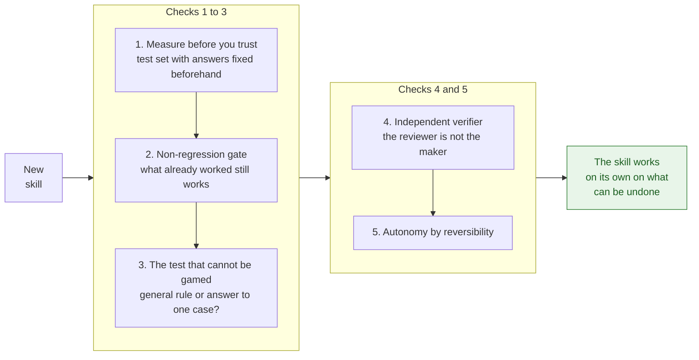

Versión en español: [README.md](README.md)

# Five checks to keep an AI skill getting things right on real data

On 23 May 2026 a bulk update ran against my project's accounting database. It raised sales by 30 % without touching the offsetting entries. In one go, 2,449 of the 7,159 journal entries fell out of balance. AI agents break the same way at a different scale: a skill that worked yesterday can get things wrong today without throwing a single error. The five checks below are how I catch that in time. I wrote them for anyone building skills or agents on real data, whether you're an analyst, a developer or a technical lead. They come from a fictional set of books I keep as a financial controller: TechAcces S.L., with synthetic data in MySQL, Power BI on top and Claude agents proposing journal entries. The figures in these cases come from that project's private history, so they can't be recomputed from this repository. What can be measured in the open is in the repositories linked at the end.

## What a skill is

A skill is a Markdown file that an AI agent reads before it starts work. It gives the agent domain judgement, the rules it has to follow and the points where it should stop and ask. The agent reads it the way it reads any other instruction. That's why a skill that used to work can quietly start failing when the model changes or the data shifts. There's a from-scratch explanation with examples in [llm-eval-contable](https://github.com/jleonceo/llm-eval-contable).

## The five checks

They're listed in the order I apply them to a skill, from the day I write it to the day I let it run on its own.

### 1. Measure before you trust

A DAX measure in my Power BI dashboard returned +€2,571,241.27. The right figure, sales minus expenses, was +€322,957.19. The measure added up only the debit side of account group 6 and ignored the credits, which is where returns and discounts sit. The dashboard loaded. The number looked plausible, so nothing on screen hinted at a problem.

Ever since, every new measure gets checked against a SQL query. It has to match to the cent before it ships. I do the same with skills by another route: before I rely on one, I run it against a set of test cases whose correct answers I pin down in advance, known in model evaluation as a golden set. It's the same set I rerun in every check that follows. An automated grader with written rules produces the score, so two people running it get the same result.

To set this up you need three pieces. First, a handful of cases that look like the real work. Second, the expected answer for each one, written before you see what the skill says. Third, a script that compares the two and returns a score, which lets you rerun the test whenever you touch something.

The test set also has to be able to fail. One that only checks that good answers pass stays green with the skill broken. A green that can't turn red proves nothing. That's why every set carries at least one case that must come out red, and why from time to time I plant a mistake on purpose in whatever the set guards, to see whether it catches it. Two of the repositories at the end measure exactly this: [guardianes-verificados-ia](https://github.com/jleonceo/guardianes-verificados-ia) breaks the guardrails on purpose, and [detector-control-negativo](https://github.com/jleonceo/detector-control-negativo) counts the test suites that would pass with the code broken.

### 2. The no-regression gate

When a skill fails in a new way, I act on that first failure. What I control is when a fix gets accepted. The gate has two conditions:

1. The change fixes more cases than it breaks.
2. No case that used to pass starts failing.

You rerun every earlier case in the same step as the edit. Waiting to see whether something breaks later only delays the moment you find out. I learned this from a fix aimed at a single case that sank the whole group covering new suppliers and customers, since 6 of its 9 cases started asking for review for no reason as soon as it went in. I rolled it back.

A skill doesn't always help either. The [SkillsBench](https://arxiv.org/abs/2602.12670) study compared agents with and without skills written by people across 84 tasks. On average the skills raised the pass rate, but in 16 of the 84 tasks the result got worse with the skill than without it (18 in the [version presented at NeurIPS](https://neurips.cc/virtual/2026/poster/139353)). The skills the model wrote for itself didn't improve the result at all. Hence the gate: a skill gets measured against the same test set before and after, never taken on trust.

If you already have the test set from the previous check, the gate is a script that runs it before and after the change and compares the results case by case. Keep both runs, because they're the evidence that goes into the decision log.

### 3. A test you can't game

On 30 May 2026 I settled on a principle: the simulation adapts to the system. In practice, when a test fails, the only things you may touch are the test's own variables. That means an expected answer that was set wrong, or the test script. The skill, the data and the business rules stay as they are, even if the test stays red. Bend them until it passes and the score stops measuring the real work.

Three days later came the first attempt at gaming it. With one case failing, the agent helping me improve a data analysis skill wrote two new rules while looking straight at the test's reference figure, with no aim other than hitting it on the next run. One reclassified shifted years and the other was a `drop_duplicates`. The second change also deleted 4,198 rows instead of 1,500. It had wiped out legitimate duplicates. The resulting skill scored 0 out of 3. I spotted it straight away and everything was reverted. That day I understood that the no-regression gate can't catch this. A gamed fix can repair the failing case without breaking any of the others. The only defence is one question for every change: is this general judgement, or the answer to this one case? Something useful did come out of that session. How to handle European versus American number formats depends on who exported the file. It was rewritten as a general five-step rule that works for any input file.

The second attempt ran the other way and is harder to spot. The expected answer for a case was changed on the grounds that it was the account normally used for that kind of entry. A look at the database showed that the account didn't exist. The test had been bent to fit the system's mistake. That change was rolled back as well, the same way as the first.

In your own project, every change to an expected answer needs a justification against the source of truth. That source might be the database or the regulation. Every new rule in a skill should make sense without naming the case that prompted it. If you have to quote the test figure to justify a rule, what you have is that case's answer dressed up as judgement. Take it out before you run the test set again.

### 4. The independent verifier

Whoever produces a result doesn't get to sign it off. Every finding or proposal from an agent goes through a second agent that reviews it from scratch before I act. These are the cases that convinced me:

- On 29 May 2026 three auditing agents came back with 10 findings. The verifier confirmed 8, rated 1 as partly right and flagged 1 as false. Without it I'd have fixed something that was fine.
- During an evaluation of the accounting system, the validating agent blocked two correct journal entries. It claimed their accounts didn't exist. A check against the database showed they did, so the reviewer's verdict also gets tested against the data before anyone acts on it.
- On 5 June 2026 a sceptical verifier knocked down a claim I was about to use as a product's selling point. The claim was that no other platform had anything like CLAUDE.md. ChatGPT and Gemini both have it, so does Cursor, and there's also the AGENTS.md standard.

What changes the outcome most is what you hand the verifier. I measured it on 31 July 2026 on the same file. One verifier that was given the list of findings reported 0 false ones, while another that only got the artefact and the task caught 1 false finding and 8 defects the list never mentioned anywhere. In practice, give the review to a different agent from the one that produced the result. Hand it the artefact and what it needs to check. **Never pass it the list of findings**: with that list in front of it, the verifier found fewer problems.

### 5. Autonomy based on reversibility

This last check decides what the agent may do without asking you. The harder an action is to undo, the more human control it gets.

| Level | What falls here | What the agent does |
|---|---|---|
| Autonomous | Queries, analysis, alerts and drafts in a table kept apart from the live data | Goes ahead without asking |
| Autonomous with notice | Improvement proposals and candidate test cases | Goes ahead and lets you know |
| Confirmation required | Writing to the live data and changing a skill in use | Waits for your go-ahead |
| Human only | Deleting, no exceptions | You do it yourself |

I enforce the deletion rule on the resource itself. The database user the agent connects with has no DELETE privilege. MySQL refuses it with error 1142, whichever path the command takes. I'd suggest doing the same in your project, through the database user's own permissions. That way the lock holds even if the agent misreads its instructions.

## The decision log

Every change that clears the checks is logged with four fields:

- What changed.
- Why it changed.
- What evidence backs it, including the result of the no-regression gate.
- What was ruled out.

The fourth is the one almost nobody fills in. It's also the most valuable when, months later, someone proposes an option that was already tried and rejected. The template lives in [docs/plantilla_registro_decisiones.md](docs/plantilla_registro_decisiones.md). It comes with a real filled-in example, a wage garnishment, with its three rejected options: accounts 410, 475 and 52x. Copy it into your project. Add an entry every time a change gets through the gate, with both test runs in the evidence field.

## Where to see the method at work

### Evaluating skills and agents

- [llm-eval-contable](https://github.com/jleonceo/llm-eval-contable) · eval-driven development of an accounting skill with 50 cases, from 66 % to 100 % in six iterations, reproducible with the bundled grader
- [accounting-agent-swarm](https://github.com/jleonceo/accounting-agent-swarm) · four agents for bookkeeping with a test set, grader, no-regression gates and an independent verifier; scores 93.3 out of 100 with zero false positives
- [orquestacion-enjambres-ia](https://github.com/jleonceo/orquestacion-enjambres-ia) · routing across several agents, blind-evaluated, 15 out of 15

### Verifying with code

- [verificacion-determinista-ia](https://github.com/jleonceo/verificacion-determinista-ia) · data consistency checked with arithmetic, no AI involved
- [guardianes-verificados-ia](https://github.com/jleonceo/guardianes-verificados-ia) · checks, by mutating them, that an AI's guardrails actually block
- [gobernanza-agentes-verificada](https://github.com/jleonceo/gobernanza-agentes-verificada) · checks with code that an agent system still works the way it was designed
- [adherencia-reglas](https://github.com/jleonceo/adherencia-reglas) · measures from the local history whether the agent follows the rules you wrote for it
- [detector-control-negativo](https://github.com/jleonceo/detector-control-negativo) · counts the test suites that would pass with the code broken

### Protecting what goes out and what the agent remembers

- [pii-output-gate](https://github.com/jleonceo/pii-output-gate) · blocks text containing personal data before it's published
- [agent-memory-governance](https://github.com/jleonceo/agent-memory-governance) · governance for an agent's persistent memory
- [claude-code-context-management](https://github.com/jleonceo/claude-code-context-management) · keeps CLAUDE.md and MEMORY.md from flooding the context

---

Built by [Juan Luis León Rodríguez](https://juanluisleon.vercel.app) · May-November 2026 · Licence [CC BY-NC-SA 4.0](LICENSE)
