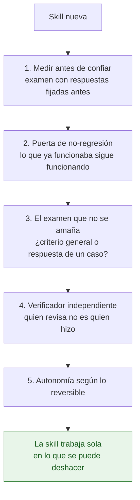

English version: [README.en.md](README.en.md)

# Cinco comprobaciones para que una skill de IA siga acertando con datos reales

El 23 de mayo de 2026 se lanzó una actualización masiva sobre la base contable de mi proyecto. Subía las ventas un 30 % sin tocar sus contrapartidas. De golpe, 2.449 de los 7.159 asientos quedaron descuadrados. Con los agentes de IA pasa lo mismo a otra escala: una skill que ayer acertaba puede equivocarse hoy sin dar ningún error. Estas cinco comprobaciones sirven para enterarte a tiempo. Las he escrito para quien construye skills o agentes que trabajan sobre datos reales, sea analista, desarrollador o responsable técnico. Salen de una contabilidad ficticia que llevo como controller financiero: TechAcces S.L., con datos sintéticos en MySQL, Power BI encima y agentes de Claude que proponen asientos. Las cifras de los casos salen del historial privado de ese proyecto, así que desde este repositorio no se pueden rehacer. Lo que sí se mide en abierto está en los repositorios enlazados al final.

## Qué es una skill

Una skill es un fichero de texto en Markdown que un agente de IA lee antes de trabajar. Le da el criterio del dominio, las reglas que debe respetar y los casos en que tiene que parar y preguntar. El agente la interpreta como cualquier otra instrucción. Por eso una skill que funcionaba puede fallar en silencio cuando cambia el modelo que la lee o cambian los datos. Si quieres la explicación desde cero, con ejemplos, la tienes en [llm-eval-contable](https://github.com/jleonceo/llm-eval-contable).

## Las cinco comprobaciones

Van en el orden en que se las aplico a una skill, desde que la escribo hasta que la dejo trabajar sola.

### 1. Medir antes de confiar

Una medida DAX de mi panel de Power BI daba +2.571.241,27 €. El resultado correcto, ventas menos gastos, era +322.957,19 €. La medida sumaba solo el debe del grupo 6 e ignoraba el haber, que es donde van las devoluciones y los descuentos. El panel cargaba. La cifra parecía razonable, así que a simple vista nada indicaba que estuviera mal.

Desde entonces cada medida nueva se cruza con una consulta SQL. Tiene que coincidir al céntimo antes de publicarla. Con las skills hago lo mismo por otra vía: antes de confiar en una, la examino contra una batería de casos cuya respuesta correcta fijo antes de lanzarla, lo que en evaluación de modelos se conoce como golden set. Es la misma batería que vuelvo a lanzar en cada una de las comprobaciones siguientes. La nota la pone un corrector automático con reglas escritas, de modo que dos personas que lo ejecuten obtienen la misma puntuación.

Para montarlo en tu proyecto necesitas tres piezas. La primera son unos casos parecidos al trabajo real. La segunda, la respuesta esperada de cada uno, escrita antes de ver lo que contesta la skill. La tercera es un script que compare las dos y devuelva la nota, que te permitirá repetir el examen cada vez que toques algo.

La batería tiene que poder suspender. Una que solo comprueba que lo bueno pasa sale en verde aunque la skill esté rota. Un verde que no puede ponerse en rojo no demuestra nada. Por eso cada batería lleva al menos un caso que tiene que salir en rojo, y de vez en cuando meto un error a propósito en lo que vigila para ver si lo detecta. Dos de los repositorios del final miden justo esto: [guardianes-verificados-ia](https://github.com/jleonceo/guardianes-verificados-ia) rompe los guardarraíles a propósito y [detector-control-negativo](https://github.com/jleonceo/detector-control-negativo) cuenta los bancos de pruebas que darían verde con el código roto.

### 2. La puerta de no-regresión

Cuando una skill falla de una forma nueva, actúo en ese primer fallo. Lo que controlo es cuándo acepto el arreglo. Para eso le pongo una puerta con dos condiciones:

1. El cambio arregla más casos de los que rompe.
2. Ningún caso que antes pasaba deja de pasar.

En el mismo movimiento en que tocas la skill relanzas todos los casos anteriores. Esperar a ver si algo se estropea más adelante solo retrasa el momento de descubrirlo. Lo aprendí con un arreglo pensado para un único caso que hundió todo el grupo de proveedores o clientes nuevos, porque 6 de sus 9 casos pasaron a pedir revisión sin ningún motivo en cuanto lo apliqué. Lo revertí.

Una skill tampoco ayuda siempre. El estudio [SkillsBench](https://arxiv.org/abs/2602.12670) comparó agentes con y sin skills escritas por personas en 84 tareas. De media, las skills subieron los aciertos, pero en 16 de las 84 tareas el resultado fue peor con la skill que sin ella (18 en la [versión presentada en NeurIPS](https://neurips.cc/virtual/2026/poster/139353)). Las skills que escribió el propio modelo no mejoraron el resultado. Por eso la puerta: una skill se mide con la misma batería antes y después, nunca se da por buena de antemano.

Si ya tienes la batería de la comprobación anterior, la puerta es un script que la ejecuta antes y después del cambio y compara caso a caso. Guarda los dos resultados, porque son la evidencia que irá al registro de decisiones.

### 3. El examen que no se amaña

El 30 de mayo de 2026 fijé un principio: la simulación se adapta al sistema. En la práctica significa que, cuando un examen falla, solo puedes tocar sus propias variables. Son la respuesta esperada si estaba mal fijada y el guion de la prueba. La skill, los datos y las reglas del negocio se quedan como estaban aunque el examen siga en rojo. Si los cambias para que pase, la nota deja de medir el trabajo real.

Tres días después llegó el primer amaño. Con un caso fallando, el agente que me ayudaba a mejorar una skill de análisis de datos escribió dos reglas nuevas mirando la cifra de referencia del examen, con la única intención de clavarla en la siguiente pasada. Una reclasificaba años desplazados y la otra era un `drop_duplicates`. El segundo cambio borró además 4.198 filas en lugar de 1.500. Se había llevado por delante duplicados legítimos. La skill resultante sacó 0 de 3. Lo vi enseguida y se revirtió todo. Aquel día entendí que la puerta de no-regresión no protege de esto. Un amaño puede arreglar el caso que falla sin romper ninguno de los demás. La única defensa es una pregunta ante cada cambio: ¿es criterio general o es la respuesta de este caso concreto? De la misma sesión salió algo aprovechable. El tratamiento del formato numérico europeo frente al americano depende de quién exportó el fichero. Se reescribió como un criterio general de cinco pasos que vale para cualquier fichero de entrada.

El segundo amaño fue en sentido contrario y cuesta más verlo. Se cambió la respuesta esperada de un caso con el argumento de que era la convención de cuentas. Al consultar la base de datos, esa cuenta no existía. Se había adaptado el examen al error del sistema. Ese cambio también se revirtió, igual que el primero.

En tu proyecto, cada cambio en una respuesta esperada tiene que llevar su justificación contra la fuente de verdad. Esa fuente puede ser la base de datos o la norma. Cada regla nueva en una skill tiene que poder explicarse sin nombrar el caso que la motivó. Si para justificarla necesitas citar la cifra del examen, lo que tienes es la respuesta de ese caso con forma de criterio. Quítala antes de volver a lanzar la batería.

### 4. El verificador independiente

Quien produce un resultado no lo da por bueno. Cualquier hallazgo o propuesta de un agente pasa por otro agente que lo revisa desde cero antes de que yo actúe. Estos son los casos que me convencieron:

- El 29 de mayo de 2026 tres agentes auditores encontraron 10 hallazgos. El verificador confirmó 8, dio 1 por parcialmente correcto y marcó 1 como falso. Sin él habría corregido algo que estaba bien.
- En una evaluación del sistema contable, el agente validador frenó dos asientos correctos. Alegaba que sus cuentas no existían. Al comprobarlo en la base de datos existían, así que también el veredicto de quien revisa se contrasta con el dato antes de hacerle caso.
- El 5 de junio de 2026 un verificador escéptico tumbó una tesis que iba a usar como diferencial de un producto. Decía que ninguna otra plataforma tenía algo como CLAUDE.md. ChatGPT y Gemini lo tienen, Cursor también, y además existe el estándar AGENTS.md.

Lo que más cambia el resultado es lo que le das al verificador. Lo medí el 31 de julio de 2026 sobre un mismo fichero. Un verificador que recibió la lista de hallazgos dio 0 falsos, mientras que otro que solo recibió el artefacto y la tarea cazó 1 falso y 8 defectos que la lista no nombraba en ninguna parte. En la práctica, encarga la revisión a un agente distinto del que produjo el resultado. Entrégale el artefacto y lo que tiene que comprobar. **No le pases nunca la lista de hallazgos**: con ella delante encontró menos problemas.

### 5. Autonomía según lo reversible

Esta última comprobación decide qué puede hacer el agente sin preguntarte. Cuanto más difícil de deshacer es una acción, más control humano lleva.

| Nivel | Qué entra | Qué hace el agente |
|---|---|---|
| Autónomo | Consultas, análisis, alertas y borradores en una tabla aparte de los datos reales | Lo hace sin preguntar |
| Autónomo con aviso | Propuestas de mejora y candidatos a casos de examen | Lo hace y te avisa |
| Confirmación obligatoria | Escribir en los datos reales y cambiar una skill en uso | Espera tu confirmación |
| Solo humano | Borrar, sin excepción | Lo haces tú |

El borrado lo garantizo en el propio recurso. El usuario de base de datos con el que conecta el agente no tiene permiso de DELETE. MySQL se lo niega con el error 1142, llegue la orden por donde llegue. Te recomiendo hacerlo igual en tu proyecto, con los permisos del usuario de base de datos. Así el candado sigue cerrado aunque el agente lea mal sus instrucciones.

## El registro de decisiones

Cada cambio que supera las comprobaciones queda anotado con cuatro campos:

- Qué cambió.
- Por qué cambió.
- Qué evidencia lo sostiene, con el resultado de la puerta de no-regresión.
- Qué se descartó.

El cuarto es el que casi nadie escribe. Es también el que más vale cuando, meses después, alguien vuelve a proponer una opción ya probada y rechazada. La plantilla está en [docs/plantilla_registro_decisiones.md](docs/plantilla_registro_decisiones.md). Trae un ejemplo real rellenado, el de una nómina con embargo judicial, con sus tres descartes: las cuentas 410, 475 y 52x. Cópiala a tu proyecto. Añade una entrada cada vez que un cambio pase la puerta, con los dos resultados del examen en el campo de evidencia.

## Dónde se ve el método funcionando

### Evaluar skills y agentes

- [llm-eval-contable](https://github.com/jleonceo/llm-eval-contable) · desarrollo guiado por evaluaciones de una skill contable con 50 casos, del 66 % al 100 % en seis iteraciones, reproducible con el corrector incluido
- [accounting-agent-swarm](https://github.com/jleonceo/accounting-agent-swarm) · cuatro agentes para contabilidad con batería de casos, corrector, puertas de no-regresión y verificador independiente; nota de 93,3 sobre 100 con cero falsos positivos
- [orquestacion-enjambres-ia](https://github.com/jleonceo/orquestacion-enjambres-ia) · enrutado entre varios agentes evaluado a ciegas, 15 de 15

### Verificar con código

- [verificacion-determinista-ia](https://github.com/jleonceo/verificacion-determinista-ia) · coherencia de los datos comprobada con aritmética, sin IA
- [guardianes-verificados-ia](https://github.com/jleonceo/guardianes-verificados-ia) · comprueba, mutándolos, que los guardarraíles de una IA bloquean de verdad
- [gobernanza-agentes-verificada](https://github.com/jleonceo/gobernanza-agentes-verificada) · comprueba con código que un sistema de agentes sigue funcionando como se diseñó
- [adherencia-reglas](https://github.com/jleonceo/adherencia-reglas) · mide desde el historial local si el agente cumple las reglas que le escribiste
- [detector-control-negativo](https://github.com/jleonceo/detector-control-negativo) · cuenta los bancos de pruebas que darían verde con el código roto

### Proteger lo que sale y lo que recuerda el agente

- [pii-output-gate](https://github.com/jleonceo/pii-output-gate) · bloquea el texto con datos personales antes de publicarlo
- [agent-memory-governance](https://github.com/jleonceo/agent-memory-governance) · gobernanza de la memoria persistente de un agente
- [claude-code-context-management](https://github.com/jleonceo/claude-code-context-management) · evita que CLAUDE.md y MEMORY.md saturen el contexto

---

Construido por [Juan Luis León Rodríguez](https://juanluisleon.vercel.app) · mayo-noviembre 2026 · Licencia [CC BY-NC-SA 4.0](LICENSE)
